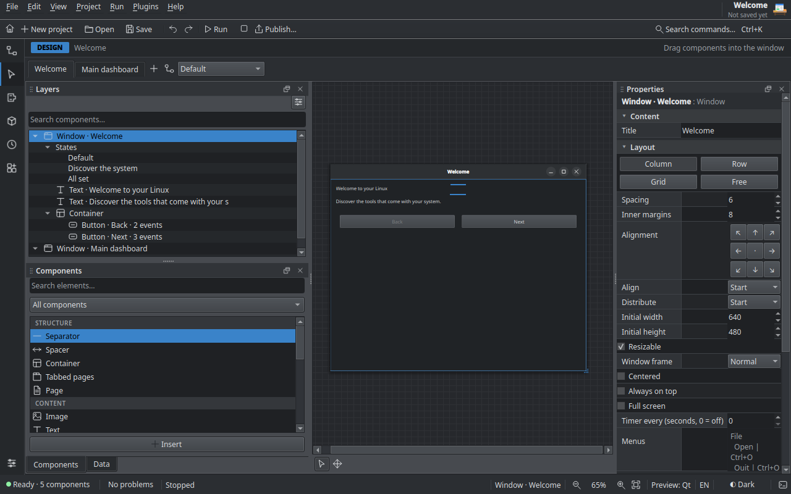

# Appearance and themes

There are two separate things to style:

- **the editor** itself, with color themes (`.mbtheme` files);
- **your apps**, with the look of each window and the style of each component.

An editor theme never changes your apps, and the other way round.

## Editor themes

Choose **Plugins › Themes…**. The window lists:

- **Built-in** themes: the default one, sober and dense, and **Desktop colors**,
  which uses your system palette like other KDE or GNOME apps;
- **Official** themes: Catppuccin, Dracula, Gruvbox, Nord and Solarized;
- **Yours**: themes you created or imported.

Pick one and click **Apply**. The light/dark switch in the status bar chooses
which half of the theme is used.



### Making a theme

Click **New theme…**, give it a name and pick the colors of each surface
(**Background**, **Bars**, **Panels**, **Lines**, **Buttons**, **Text**,
**Dim text** and the **Accent**) for dark and light. A preview shows the
result. Built-in and official themes cannot be changed; make a new one from
them instead.

**Export .mbtheme…** saves a theme to share; **Import…** adds one you
received. Your themes live in `~/.local/share/makebench/themes/`
(**Open themes folder**).

### The `.mbtheme` format

A theme is a small JSON file:

```json
{
  "format": "mbtheme",
  "version": 1,
  "name": "Nord",
  "about": "An arctic, north-bluish palette, calm and clean.",
  "accent": "#5e81ac",
  "dark": {
    "win": "#2e3440", "side": "#292e39", "base": "#242933", "line": "#434c5e",
    "btn": "#3b4252", "btnLine": "#4c566a", "fg": "#d8dee9", "mut": "#a5adbd"
  },
  "light": {
    "win": "#e5e9f0", "side": "#d8dee9", "base": "#eceff4", "line": "#c2cad6",
    "btn": "#eceff4", "btnLine": "#b3bccb", "fg": "#2e3440", "mut": "#4c566a"
  }
}
```

| Key | Meaning |
|---|---|
| `format`, `version` | always `"mbtheme"` and `1` |
| `name` | up to 60 characters |
| `about` | optional, up to 200 characters |
| `accent` | the accent color |
| `win` | window background |
| `side` | bars |
| `base` | panels |
| `line` | lines and borders |
| `btn`, `btnLine` | button fill and border |
| `fg`, `mut` | normal and dim text |

Every color is `#rrggbb`, and both `dark` and `light` need all eight keys. A
theme is only colors: it cannot run code. Files bigger than 64 KB are refused.

## The look of a window

Select a window (click an empty part of it in Design) and open **Window look**
in Properties:

- **Theme**: **System**, **Light** or **Dark**;
- **Accent color** and **Background color**;
- **Background image**: **Choose background image…** copies the image into the
  project's `assets/` folder and draws it behind the controls.
  **Change background image…** and **Remove background image** do what they say.

Each window has its own look, so a project can mix a dark main window with a
light dialog.

## Component style

Every component has a **Style** section in Properties:

| Setting | Values |
|---|---|
| **Text color** | any color |
| **Fill color** | any color |
| **Font size (pt)** | 0 keeps the default, up to 96 |
| **Rounded corners (px)** | up to 48 |
| **Bold**, **Italic** | on or off |

Styles work in Qt and in GTK apps.

**Edit › Copy style** (++ctrl+alt+c++) copies the style of the selected
component; **Edit › Paste style** (++ctrl+alt+v++) applies it to every selected
component in one undo step.

## Changing the look while the app runs

| Block | Python | Does |
|---|---|---|
| **set window theme … accent …** | `ctx.set_theme("dark", "#e66100")` | switches the current window to `system`, `light` or `dark`, with an optional accent |
| **set window background …** | `ctx.set_background("#1e1e2e")` | paints the window background; `""` restores it |

For example, a *Dark mode* checkbox:

```python
def on_dark_mode_change(ctx):
    ctx.set_theme("dark" if ctx.read("dark_mode", "checked") else "system")
```

## Reusable pieces

A group of styled components can become a **reusable piece**: right-click a
component in the component tree and choose **Save as reusable piece…**, or use
the Edit menu. **Edit › Insert piece** inserts an independent copy;
**Manage pieces…** renames, exports and imports them. Makebench comes with a
few pieces, such as an *OK / Cancel bar*, a *Login form* and a *Screen header*.
