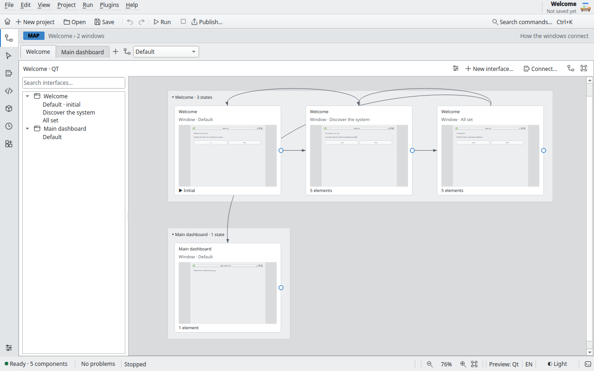
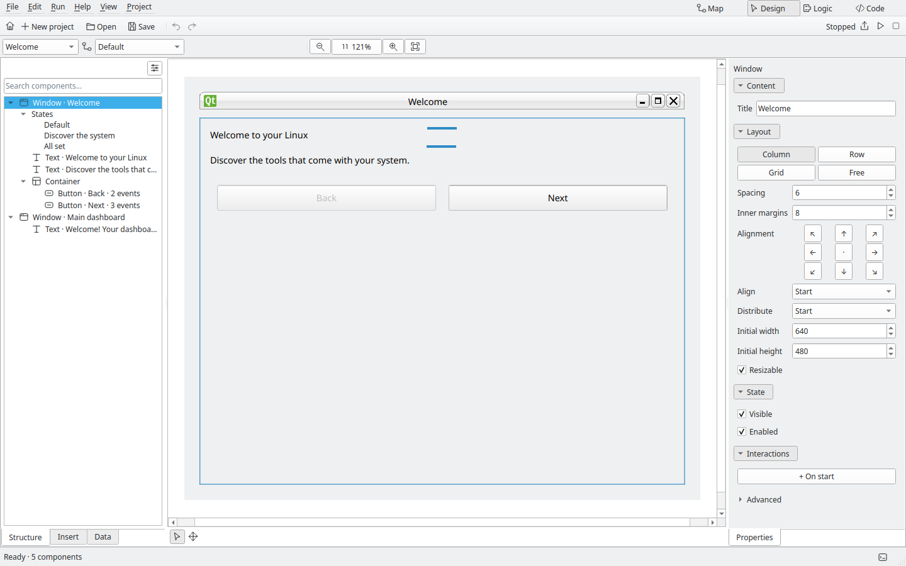
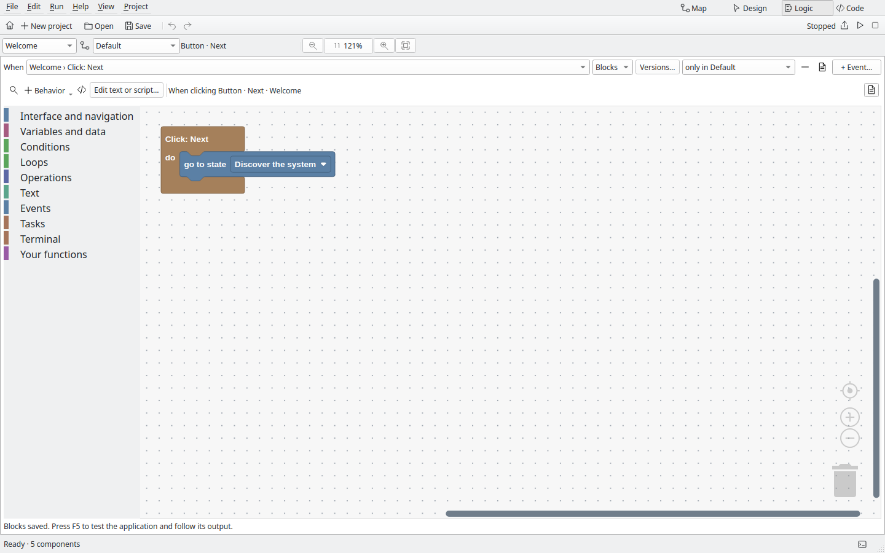
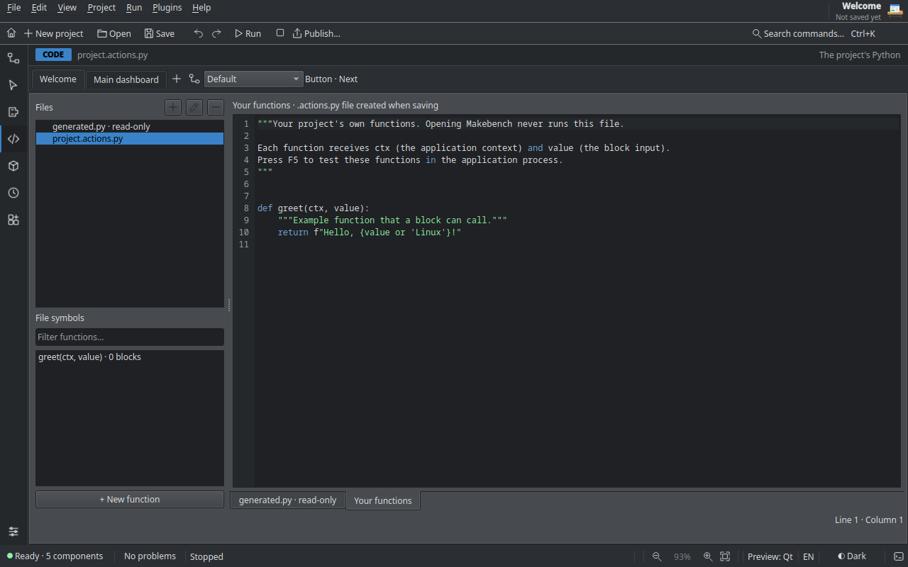

# Guia de uso do Makebench

[Read in English](user-guide.md)

Este guia percorre as quatro áreas da bancada na ordem em que um aplicativo
costuma ser construído e depois mostra como testar, depurar e exportar. Os
nomes de menus abaixo são os da interface em português (escolha o idioma em
**Exibir › Preferências…**). Pressione **F1** no editor para abrir o guia
rápido de primeiros passos, e **Ajuda › Atalhos de teclado** para ver todos os
atalhos.

## Tela inicial

- **Novo projeto…** cria um projeto a partir de um modelo, em Qt ou GTK 4. Os
  projetos novos seguem o idioma da interface: textos de exemplo e nomes de
  funções saem em português ou em inglês.
- **Abrir projeto…** abre um arquivo `.makebench.json` existente.
- **Abrir exemplo…** copia um dos exemplos incluídos para a pasta de projetos e
  abre a cópia. Os exemplos originais nunca são alterados.
- **Baixar do Git…** clona um projeto de qualquer endereço Git para a pasta de
  projetos e o abre. Nada nele roda até você apertar **F5**.

Ao fechar a janela de abertura, a área vazia mostra o botão **Mostrar a janela de
abertura**.

## A área de trabalho

A barra à esquerda troca de área; a faixa abaixo da barra de ferramentas mostra a
área atual e o projeto. Componentes, Camadas e Propriedades são painéis que você
pode soltar, encaixar em outro lugar ou fechar; **Exibir › Painéis › Restaurar
layout** os devolve. A barra de status mostra se o projeto está salvo, os problemas,
o toolkit, o zoom e um botão de claro/escuro.

O Makebench usa cores próprias por padrão. **Preferências › Aparência › Visual**
troca para as cores do desktop, e **Plugins › Temas…** escolhe, cria ou importa
temas de cores `.mbtheme`.

Abrir um projeto nunca o executa. Um projeto é um arquivo `.makebench.json`, com
um arquivo `.actions.py` ao lado para o seu Python, um pacote opcional de
módulos `makebench_user/` e uma pasta `assets/` para imagens.

## 1 · Mapa

O Mapa mostra cada janela e estado do aplicativo como cartões, com linhas para
as transições entre eles.

- Crie janelas e estados pela barra de ferramentas ou pelo menu de contexto.
- Arraste da porta de um cartão até outro para criar uma transição. A ligação é
  uma ação real de "mostrar janela" ou "mudar estado" dentro da lógica, não um
  desenho.
- Selecione uma linha para ver e mudar o evento que a dispara.
- As miniaturas dos cartões são desenhadas a partir do design, sem executar nada.

## 2 · Design

No Design você monta cada janela com controles nativos.

- Arraste componentes de **Inserir** para a tela ou para a árvore de componentes.
- Organize-os em linhas, colunas, grades, páginas ou posicionamento livre. A
  seleção pode ser movida, redimensionada, duplicada e alinhada; com vários
  componentes selecionados, **Propriedades** mostra o que eles têm em comum.
- A prévia Qt usa o estilo do seu desktop. A prévia GTK é desenhada pelo próprio
  GTK num processo privado, então o que você vê é o que o GTK vai mostrar.
- Imagens são copiadas para a pasta `assets/` do projeto quando adicionadas.

## 3 · Lógica

A Lógica diz o que acontece quando uma janela inicia ou um botão é clicado.
Cada projeto é programado com **blocos** ou com **Python**; você escolhe ao
criá-lo, e a Lógica abre o editor certo. A barra lateral lista os **Eventos**,
as **Funções** e os **Módulos** do projeto.

- **Blocos** (Blockly) funcionam como no Scratch: encaixe instruções, valores e
  condições. Campos de texto livre são sempre tratados como texto, nunca como
  Python.
- **Ver Python** mostra o código gerado pelos blocos, só para leitura.
  Selecionar um bloco destaca a linha correspondente.

As ações disponíveis incluem mostrar janelas e páginas, ler e alterar
componentes, mensagens e perguntas, registro de saída, chamar funções e
executar programas ou scripts Bash como tarefas supervisionadas. Uma
tarefa pode pedir permissão de administrador; nesse caso o Makebench usa o
Polkit e o diálogo de autenticação do próprio sistema. Ele nunca pede nem guarda
senhas.

As **Funções** juntam blocos que você usa em mais de um lugar. Escolha
**Funções próprias › Nova função…** na paleta (ou no menu ⋯), dê um nome Python
e, se quiser, entradas separadas por vírgulas. Dentro da função as entradas são
variáveis locais ("deste fluxo"), e **retornar** devolve um valor. Use
**chamar** como instrução ou **resultado de** como valor. Uma função que ainda é
chamada não pode ser removida, e o número de entradas só muda depois que você
remove as chamadas.

Os **Módulos** só organizam: escolha **⋯ › Mover para módulo…** e digite um
nome para agrupar o evento ou a função aberta com outros na barra lateral.
Deixe o nome vazio para tirar do módulo. Clique com o botão direito num bloco
para comentar ou recolher.

### Projetos em Python

Um projeto em Python guarda o código no arquivo `.actions.py` do projeto e nos
módulos em `makebench_user/`. Cada evento é ligado a uma função pelo nome: dê
dois cliques num botão (ou na janela) no Design e o Makebench acrescenta
`def on_salvar_click(ctx):` ao arquivo de ações e o abre. A lista **Eventos**
mostra todas as ligações; `ctx` dá acesso ao aplicativo (ler e alterar
componentes, mostrar páginas, registrar saída, fazer perguntas, executar
tarefas). Se a função não existir, o painel Problemas avisa.

**Projeto › Converter para Python…** transforma um projeto em blocos num projeto
Python: os blocos de cada evento viram uma função com o mesmo comportamento. O
projeto e o arquivo de ações anteriores ficam ao lado, com o sufixo
`.bak-blocks`.

- Sugestões, **F12** para ir à definição e diagnósticos enquanto você digita. A
  análise é estática: o código é lido, nunca importado ou executado.
- **Ctrl+Shift+F** busca em todos os arquivos Python do projeto, usando o que
  está aberto no editor, e não o que está no disco.
- **Ctrl+Z** num arquivo de código desfaz dentro daquele arquivo; nas outras áreas,
  desfaz a última alteração do projeto. O menu Editar mostra o que será desfeito.

## Testar e depurar

- **F5** inicia o aplicativo num processo separado e supervisionado.
  **Shift+F5** para o aplicativo junto com as tarefas que ele iniciou.
- A gaveta inferior (**Ctrl+J**) mostra saída, problemas, tarefas com stdout e
  stderr, um terminal interativo e os resultados da busca.
- Quando algo falha, **Ir ao erro** abre o bloco, o nó ou a linha que causou o erro.
- **F9** inicia a depuração. Coloque pontos de parada em blocos ou linhas de
  Python (clique na margem do código ou use o menu do bloco). Enquanto pausado,
  você vê a pilha e uma cópia somente leitura das variáveis, e pode continuar,
  ir ao próximo passo, entrar ou sair de uma função.

O processo de teste mantém o editor responsivo, mas não é uma sandbox: o projeto
roda com as permissões do seu usuário. Revise projetos de terceiros antes de
testá-los.

## Exportar

**Projeto › Exportar aplicativo…** (**Ctrl+Shift+E**) abre a janela de exportação.

- **Fonte Python** gera um ZIP que roda com Python e o toolkit instalados.
- **DEB**, **RPM** e **AppImage** incluem o Python e o toolkit escolhido, então o
  resultado roda sem instalar mais nada. **Flatpak** usa o runtime do GNOME para
  GTK e o do KDE para Qt, e mantém o isolamento do Flatpak.
- **Construir com** escolhe entre ferramentas que o Makebench prepara em
  contêineres Podman sem root (guardadas em `~/.cache/makebench/builders`), as
  ferramentas instaladas no sistema ou a escolha automática. Preparar as
  ferramentas é sempre um passo explícito, com saída visível e botão Cancelar.
- **Exportar somente a receita** gera os arquivos de construção num ZIP, sem
  construir o pacote.
- **Editor Makebench (AppImage)** no campo **Exportar** constrói o próprio editor
  como AppImage, já com os exemplos.

Construir nunca executa o seu projeto. Edite nome, identificador, versão, ícone
e idioma do aplicativo em **Aplicativo…**.

## Histórico de versões, nuvem e peças

- **Histórico de versões** (Projeto › Histórico de versões): ative uma vez e cada
  salvamento vira uma versão guardada com Git na pasta do projeto. Na janela você vê
  as versões por dia, dá nome a uma ou restaura. Restaurar nunca apaga nada: o estado
  atual é salvo antes e os arquivos antigos voltam como uma versão nova.
- **Na nuvem:** na mesma janela conecte qualquer endereço Git (GitHub, GitLab,
  Codeberg…) ou crie um repositório privado no GitHub quando o `gh` estiver logado.
  **Enviar** e **Buscar atualizações** só rodam quando você clica. O Makebench nunca
  pede nem guarda senha: usa o login que o computador já tem (`gh`, SSH ou o
  chaveiro de credenciais).
- **Peças reutilizáveis:** botão direito num componente › *Salvar como peça
  reutilizável*. Suas peças aparecem em *Minhas peças* na aba Inserir e entram como
  cópias independentes; dá para renomear, exportar e importar.
- **Plugins:** veja [plugins.md](plugins.md) (em inglês). Todos vêm desligados até
  você ligar cada um.
- **Aparência da janela:** selecione uma janela e escolha tema (Sistema, Claro,
  Escuro), cor de destaque e cor de fundo. Na lógica use `ctx.set_theme(...)` e
  `ctx.set_background(...)`.
- **Exemplos completos:** *Oficina completa* usa todos os tipos
  de componente, várias janelas com aparências diferentes, um estado, uma tarefa, um
  terminal, um módulo próprio e um ponto de parada. Abra a janela *Roteiro* dentro
  deles para um passeio curto.

## Preferências

**Exibir › Preferências…** (**Ctrl+,**) reúne as configurações do editor: idioma
da interface, tema, tamanho do texto, fonte do código, pasta para novos projetos
e mais. O idioma da interface vale a partir da próxima vez que o Makebench abrir.
A página **Sobre** tem um botão que abre este guia.

## Arquivos e salvamento

- **Ctrl+S** salva o projeto, seus arquivos Python e as imagens. Cada arquivo é
  gravado de forma atômica, mas o conjunto não é salvo como uma única transação;
  se o salvamento falhar no meio, o Makebench diz quais arquivos foram gravados.
- Quando o formato do projeto é atualizado, o arquivo anterior fica guardado como
  `.bak-vN` ao lado dele.
- Se o seu Python mudou fora do Makebench enquanto estava aberto, o Makebench
  oferece **Recarregar arquivo** ou **Manter minha versão**, em vez de
  sobrescrever sem avisar.
